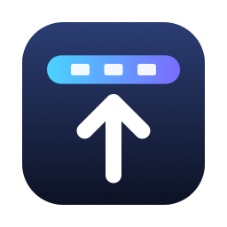
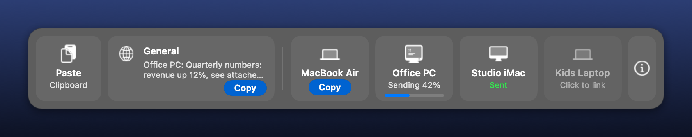

<p align="center">
  
</p>

<h1 align="center">DropDock</h1>

<p align="center">
  Drag a file to the top of your screen and drop it on another computer.<br>
  A small, native app for Mac and Windows that sends files and formatted clipboard text
  between your computers on the same Wi-Fi.
</p>

<p align="center">
  <a href="https://github.com/myfxpaddy/dropdock/releases/latest"></a>
  <a href="LICENSE"></a>
  
</p>

<p align="center">
  
</p>

## Features

* **Drag to the top edge to send.** The bar slides down from the top of the screen showing your
  computers. Drop files or folders on one and they arrive in its `Documents/DropDock` folder.
* **Share your clipboard with formatting.** Copy anything, click **Paste**, and pick a computer. Bold,
  headings, lists, tables, links and images survive the trip, between Macs and PCs alike.
* **A shared General board.** Paste to General and every one of your computers can copy it from the bar.
* **Mac and Windows together.** Both apps speak the same protocol, so a Mac and a PC can send to each
  other in either direction.
* **Automatic.** It starts with the computer, finds your other computers by itself, and only needs
  linking once per computer.
* **Private.** Computers must be linked before they can talk, everything is encrypted, and nothing
  leaves your local network.
* **Light.** Native on each system, with no CPU use while idle (about 15 MB of memory on a Mac).
  The Mac app is 1.6 MB; the Windows app is one 290 KB file.

## Installation

DropDock has to be installed on every computer that should send or receive.

| | Requirements |
|---|---|
| Mac | macOS 13 or newer, Apple Silicon or Intel |
| Windows | Windows 10 or 11 (uses the built-in .NET Framework 4.8), no admin rights needed |

### Mac

Run this in Terminal. Running it again later updates DropDock and keeps your settings.

```sh
curl -fsSL https://raw.githubusercontent.com/myfxpaddy/dropdock/main/install/mac.sh | bash
```

The [script](install/mac.sh) downloads the latest release, installs `DropDock.app` in Applications,
starts it, and checks it is running. On first launch DropDock sets itself to start at login, adds
itself to the Dock, and puts an alias on the Desktop.

macOS then asks a few one-time questions on screen. Click **Allow** for each:

| Question | Why it is needed |
|---|---|
| Find devices on your local network | To see your other computers |
| Access files in your Documents folder | To save what you receive in `Documents/DropDock` |
| Access files in your Desktop folder | To put the alias on the Desktop |
| Paste from other apps (newer macOS, the first time you click Paste) | To read what you copied |

<details>
<summary>Install without Terminal</summary>

1. Download `DropDock-mac.zip` from the [latest release](https://github.com/myfxpaddy/dropdock/releases/latest)
   and unzip it.
2. Open DropDock. If macOS says it cannot be opened, go to **System Settings > Privacy & Security**
   and click **Open Anyway**. (DropDock is not signed with a paid Apple developer certificate.)
3. When it offers to move itself to Applications, click **Move to Applications**.

</details>

### Windows

Run this in PowerShell (an ordinary window, not as administrator). Running it again later updates
DropDock and keeps your settings.

```powershell
irm https://raw.githubusercontent.com/myfxpaddy/dropdock/main/install/windows.ps1 | iex
```

The [script](install/windows.ps1) downloads the latest release and runs it. `DropDock.exe` installs
itself into `%LOCALAPPDATA%\Programs\DropDock`, adds Start menu and Desktop shortcuts, starts with
Windows, and sits in the tray. Then:

1. **Firewall.** When Windows Defender Firewall asks, tick **Private networks** and click
   **Allow access**. Without this, other computers cannot reach this PC.
2. **Private network.** The Wi-Fi must be a Private network: **Settings > Network & internet > Wi-Fi >
   (your network) > Private network**. Check with `Get-NetConnectionProfile`.
3. **Pin it.** Windows does not let apps pin themselves. Open **Start**, right-click **DropDock**, and
   choose **Pin to taskbar**.

<details>
<summary>Fixing the firewall or Controlled folder access afterwards (one admin approval)</summary>

If the firewall question was dismissed, add the rule (and remove any block rule Windows created):

```powershell
$exe = "$env:LOCALAPPDATA\Programs\DropDock\DropDock.exe"
Start-Process powershell -Verb RunAs -ArgumentList '-NoProfile', '-Command', "Get-NetFirewallApplicationFilter -Program '$exe' -ErrorAction SilentlyContinue | Get-NetFirewallRule | Where-Object Action -eq Block | Remove-NetFirewallRule; New-NetFirewallRule -DisplayName 'DropDock' -Direction Inbound -Program '$exe' -Action Allow -Profile Private,Domain"
```

If Windows Security's Controlled folder access is on (`(Get-MpPreference).EnableControlledFolderAccess`
returns `1`), allow DropDock to save into Documents:

```powershell
$exe = "$env:LOCALAPPDATA\Programs\DropDock\DropDock.exe"
Start-Process powershell -Verb RunAs -ArgumentList '-NoProfile', '-Command', "Add-MpPreference -ControlledFolderAccessAllowedApplications '$exe'"
```

</details>

<details>
<summary>Install without PowerShell</summary>

Download `DropDock.exe` from the [latest release](https://github.com/myfxpaddy/dropdock/releases/latest)
and double-click it. If SmartScreen says "Windows protected your PC", click **More info**, then
**Run anyway**. Then follow steps 1 to 3 above.

</details>

### Installing with Claude Code

Open [Claude Code](https://claude.com/claude-code) on the new computer and paste the prompt for it:
[Mac prompt](install/prompt-mac.txt) or [Windows prompt](install/prompt-windows.txt). Claude installs
DropDock, checks it works, and tells you what to click. The same prompts are in the app: click the
**i** at the end of the bar, or choose **Set Up Another Computer** from the DropDock menu.

### Linking your computers

New installs do not trust each other, so nobody else on the same network can send you anything.
Link each new computer once:

1. On the new computer, open the bar (see below). Your other computers appear dimmed with
   **Click to link**. Click one.
2. Both computers show the same six-digit code. On the other computer, check that it matches and
   click **Allow**.

Every computer linked this way joins the same group and sees all the others. If the automatic way
cannot reach a computer, use **Link Key > Copy Link Key** on a linked computer and
**Link Key > Enter a Link Key** on the new one.

## Using DropDock

| To | Do this |
|---|---|
| Open the bar | Rest the pointer at the top edge of a screen for a moment, or click DropDock in the Dock (Mac), the tray (Windows), the menu bar, or the Desktop shortcut |
| Send files | Drag them to the top edge of the screen and drop them on a computer. Drop on **General** to send to every computer |
| Send by picking files | Click a computer in the bar, or drop files on the DropDock icon and pick a computer |
| Paste to one computer | Copy something, click **Paste**, click the computer. It lands on that computer's clipboard, ready for Command-V or Ctrl+V |
| Paste to all computers | Click **Paste**, then **General**. On any computer, click **Copy** on General |
| Find received files | `Documents/DropDock` on the receiving computer. A name that already exists becomes `name (2)` |

With several monitors, the top edge is the top of any screen that has no other screen above it.

The DropDock menu (menu bar on Mac, tray on Windows) also has: **Set Up Another Computer**,
**Open Received Files**, **Link Key**, **Unlink This Computer**, and switches for **Start at Login**
(**Start with Windows** on a PC),
**Put Clips Sent Here on the Clipboard**, **Open Bar When Pointer Rests at the Top Edge**, and
**Keep in Dock** (Mac). On Windows it also has **Uninstall DropDock**.

## Troubleshooting

**Other computers do not appear.**
Both computers must be on the same network. Guest Wi-Fi and many office or hotel networks keep
devices apart, and DropDock cannot work across that. A VPN can also get in the way. On a Mac, check
**System Settings > Privacy & Security > Local Network**. On Windows, check the firewall and that the
network is Private (see [Windows](#windows)).

**Checking the connection.** Look for `found <name> at <address>` lines in the log, and test the port:

| | Mac | Windows |
|---|---|---|
| Log | `tail -20 ~/Library/Application\ Support/DropDock/dropdock.log` | `Get-Content "$env:APPDATA\DropDock\dropdock.log" -Tail 20` |
| Port test | `nc -vz <address> 47821` | `Test-NetConnection <address> -Port 47821` |

**"Not linked" or "different link key".** Link the two computers again.

**Received files are missing.** They are in `Documents/DropDock`. On a Mac, check Documents access in
**Privacy & Security > Files and Folders**. On Windows, check Controlled folder access (see
[Windows](#windows)).

**macOS asks for permissions again after an update.** Expected: macOS treats each unsigned build as a
new app. Click **Allow** again.

## Uninstalling

**Mac:**

```sh
launchctl bootout gui/$(id -u)/app.dropdock.agent 2>/dev/null
rm -f ~/Library/LaunchAgents/app.dropdock.agent.plist ~/Desktop/DropDock
rm -rf /Applications/DropDock.app ~/Applications/DropDock.app "$HOME/Library/Application Support/DropDock"
```

Then drag DropDock out of the Dock. **Windows:** right-click the tray icon and choose
**Uninstall DropDock**. On both, received files stay in `Documents/DropDock`.

## How it works

DropDock is a native app on each platform, built to cost nothing while it waits:

* **Mac:** Swift and AppKit, a menu bar app started by a per-user LaunchAgent (`app.dropdock.agent`)
  that also restarts it if it crashes.
* **Windows:** C# on .NET Framework 4.8, which ships with Windows, so the app is one small exe. It
  starts from the `HKCU\...\Run` registry key.
* **Finding computers:** a small UDP broadcast on port 47820 at start-up, after waking or a network
  change, and every 50 seconds.
* **Transfers:** TCP on port 47821, encrypted with AES-256 and authenticated with HMAC-SHA256, in
  512 KB chunks written to a hidden staging folder and moved into place when complete.
* **The top edge:** DropDock is told about mouse events only as they happen (a global event monitor on
  Mac, a low-level mouse hook on Windows) and rejects almost all of them with one comparison.
* **Clipboard:** plain text, HTML, RTF and PNG are sent together, and the receiver puts every format on
  its clipboard so each app picks the richest one it understands. Windows' `HTML Format` header is
  converted in both directions.

**Security.** Computers only talk after proving they hold the same 100-bit group key. Linking uses a
P-256 key exchange confirmed by a six-digit code shown on both screens, so nobody can join silently.
Connections are only accepted from local network addresses, and received file names are cleaned so
nothing can be written outside `Documents/DropDock`.

| | Mac | Windows |
|---|---|---|
| App | `/Applications/DropDock.app` | `%LOCALAPPDATA%\Programs\DropDock\DropDock.exe` |
| Settings and link key | `~/Library/Application Support/DropDock/state.json` | `%APPDATA%\DropDock\state.json` |
| Received files | `~/Documents/DropDock` | `Documents\DropDock` |

The link key in `state.json` is what lets your computers trust each other. Keep it private.

## Building from source

You need the Xcode command line tools (for the Mac app) and the [.NET SDK](https://dotnet.microsoft.com/download)
(for the Windows app; it builds the .NET Framework 4.8 exe on Mac or Windows).

```sh
mac/build.sh                                               # dist/DropDock.app and dist/DropDock-mac.zip
cd windows && dotnet build -c Release -o ../build/windows  # build/windows/DropDock.exe
```

```text
mac/            Swift app (Swift Package Manager; build.sh makes the universal app bundle)
windows/Core/   Windows networking, crypto and protocol, plain C# that also builds on Mac and Linux
windows/App/    Windows interface: tray, bar, mouse hook, clipboard, installer
install/        Install scripts and the Claude Code prompts (also bundled into both apps)
tests/interop/  Runs windows/Core on any OS, to test it against the Mac app
tools/          Icon generators
```

**Tests.** `tests/interop` runs the Windows networking code on any operating system, so the two apps
can be tested against each other on one Mac:

```sh
cd tests/interop && dotnet build -c Release -o ../../build/interop
../../build/interop/Interop selftest            # clipboard format, link codes and file name checks
../../build/interop/Interop serve               # a headless Windows peer
```

The Mac app has a matching command line mode: `DropDock --cli serve`, `info`,
`send <host> <port> <files>`, `clip <host> <port> <general|direct> <text>` and `link <host> <port>`.
Set `DROPDOCK_HOME`, `DROPDOCK_PORT` and `DROPDOCK_NAME` to run several isolated copies on one machine.

<details>
<summary>Protocol</summary>

Both apps implement exactly this. Any change must be made on both sides.

**Identity.** Each install has a random `id` (UUID), a `name`, `os` (`mac` or `windows`) and `kind`
(`laptop` or `desktop`).

**Groups.** A group code is 20 characters from `0123456789ABCDEFGHJKMNPQRSTVWXYZ` (100 bits), shown as
`XXXXX-XXXXX-XXXXX-XXXXX`. Typed codes are upper-cased, `-` and spaces are removed, `O` becomes `0`,
and `I` and `L` become `1`. Group key `K = SHA256("dropdock/group/v1:" + code)`. Group tag = the first
16 hex characters of `HMAC-SHA256(K, "dropdock/tag/v1")`. Computers with the same tag are linked.

**Discovery (UDP 47820).** One JSON object per packet, sent to 255.255.255.255 and to every IPv4
interface's broadcast address:

```json
{"app":"dropdock","v":1,"t":"here","id":"...","name":"Office PC","os":"windows",
 "kind":"desktop","port":47821,"tag":"0123456789abcdef","gt":1760000000000}
```

`hello` is sent at start-up, after wake and after a network change; everyone who hears it replies
with one `here` after a random 50 to 400 ms. `here` is also a heartbeat every 50 seconds. `bye` is
sent on quit and before sleep. A peer not heard from for 125 seconds is dropped. `gt` is the time of
the sender's General clip: when you hear a linked peer with an older `gt`, push your General clip to it.

**Framing (TCP 47821).** Each frame is a big-endian `u32` length and that many bytes (at most 48 MiB).
Before authentication frames are UTF-8 JSON. After it they are encrypted boxes:
`IV (16) || AES-256-CBC(enc, IV, PKCS7(plaintext)) || HMAC-SHA256(mac, u64be(seq) || IV || ciphertext)`,
with separate keys and a frame counter `seq` per direction. The plaintext is a type byte (`1` JSON,
`2` file bytes) and the body.

**Session.**

1. Client: `{"t":"hello","app":"dropdock","v":1,"id","name","os","kind","tag","nonce":b64(32 random bytes)}`.
2. Server: `{"t":"error","code":"not-linked"}` if the tag differs, otherwise
   `{"t":"hello",...,"nonce":b64(sn),"proof":b64(HMAC(K, "dropdock/server" || cn || sn))}`.
3. Client checks the proof and sends `{"t":"auth","proof":b64(HMAC(K, "dropdock/client" || cn || sn))}`.
4. Keys: `HKDF-SHA256(ikm=K, salt=cn||sn, info="dropdock/session/v1", 128 bytes)`: client to server
   `enc` and `mac` are bytes 0 to 32 and 32 to 64; server to client are 64 to 96 and 96 to 128.
5. Server sends encrypted `{"t":"ready"}`; the client sends one request.

**Files.** `{"t":"files","total":N,"count":N,"items":[{"path":"Folder/a.jpg","size":123,"dir":false}]}`.
Paths use `/` with no empty, `.` or `..` parts. The receiver answers `accept` or
`{"t":"reject","reason":"..."}`, the sender streams each file in order as type 2 frames (at most
512 KiB, never spanning two files), then `{"t":"end"}`, and the receiver answers
`{"t":"done","saved":[...]}` with the final top-level names.

**Clips.** `{"t":"clip","clip":{"id","scope":"general"|"direct","from","fromName","time","text","html","rtf":b64,"png":b64}}`,
answered with `{"t":"ok"}`. Every format is optional. `html` is a plain HTML document or fragment.

**Linking.**

1. Client: `{"t":"link","app":"dropdock","v":1,"id","name","os","kind","pub":b64(P-256 public key, 65 bytes uncompressed)}`.
2. Server: `{"t":"link-wait",...,"pub":b64(its own new key)}`.
3. Both compute `s = SHA256(ECDH shared x-coordinate)` and show
   `u32be(HMAC(s, "dropdock/sas")[0:4]) mod 1000000` as `123 456`.
4. The server asks its user (90 second limit), then sends `{"t":"link-deny"}` or
   `{"t":"link-ok","box":b64(box)}`, a box sealed with
   `HKDF-SHA256(ikm=s, salt="dropdock/link-salt", info="dropdock/link/v1", 64 bytes)` (`seq` 0) whose
   plaintext is type 1 `{"code":"<group code>"}`.

</details>

## Contributing

Contributions are welcome, from bug reports to new features.

* **Ideas and questions:** [Discussions](https://github.com/myfxpaddy/dropdock/discussions).
* **Bugs:** [open an issue](https://github.com/myfxpaddy/dropdock/issues) with your OS version, what
  you did, what happened, and the last lines of the log.
* **Code:** look for issues labelled
  [good first issue](https://github.com/myfxpaddy/dropdock/issues?q=is%3Aissue+is%3Aopen+label%3A%22good+first+issue%22)
  or [help wanted](https://github.com/myfxpaddy/dropdock/issues?q=is%3Aissue+is%3Aopen+label%3A%22help+wanted%22).
  Fork the repository, make your change on a branch, and open a pull request that explains what
  changed and how you tested it.

Guidelines:

* Keep both apps in step. A change to the protocol above must be made in `mac/` and `windows/Core/`,
  and `tests/interop` should still pass against the Mac app.
* Keep it light. No polling while idle and no new runtime dependencies without a good reason.
* Match the style of the surrounding code, and write plain, simple English in the interface and
  comments. Use plain hyphens rather than em or en dashes.
* The Windows app is newer and has had less testing on real hardware than the Mac app, so reports
  from Windows users are especially useful.

If DropDock is useful to you, please leave a star. It helps other people find it.

## License

DropDock is free software, licensed under the [GNU General Public License v3.0](LICENSE). You may use,
study, share and change it. If you distribute it or a modified version, you must make the full
source code available under the same license.

Copyright (C) 2026 Joseph Obasi and DropDock contributors.
